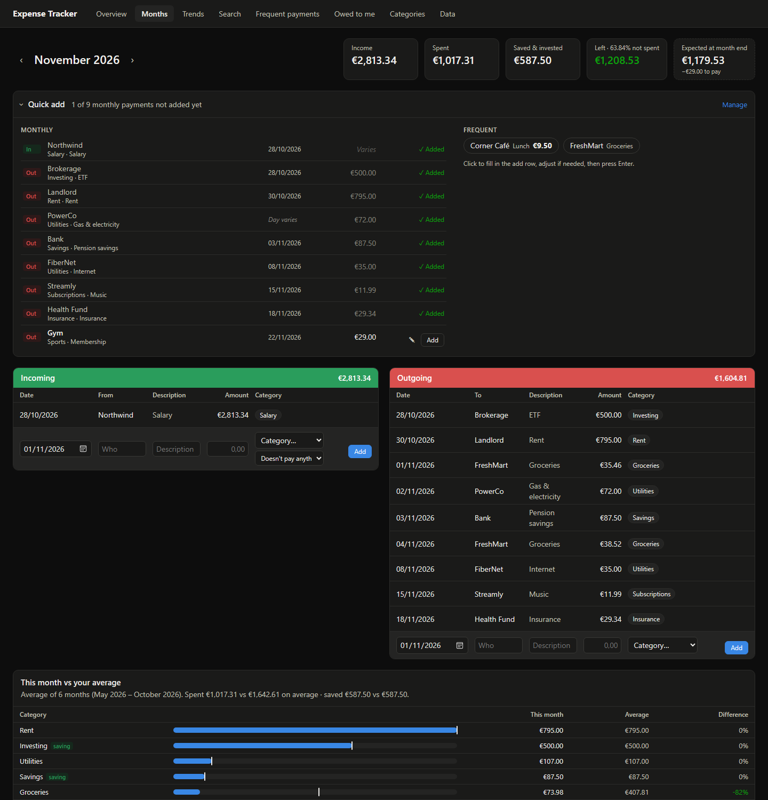
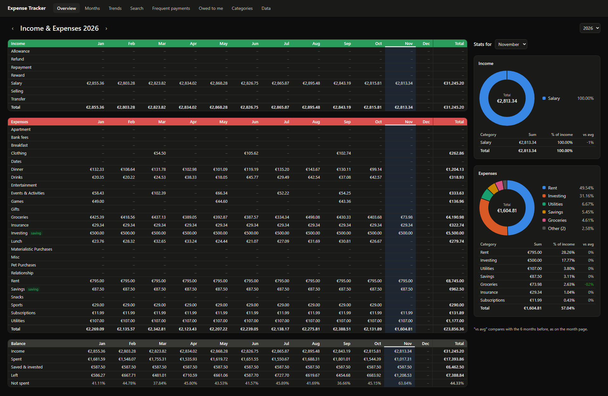
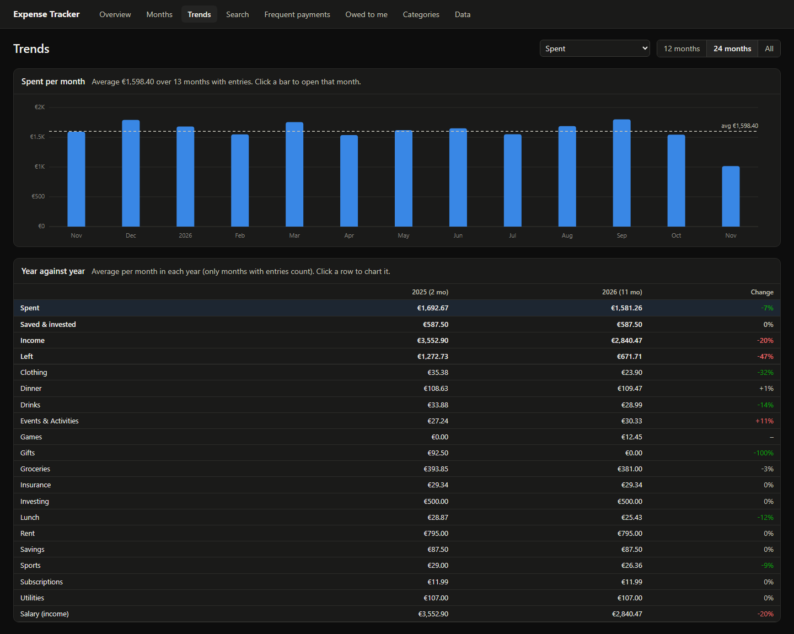
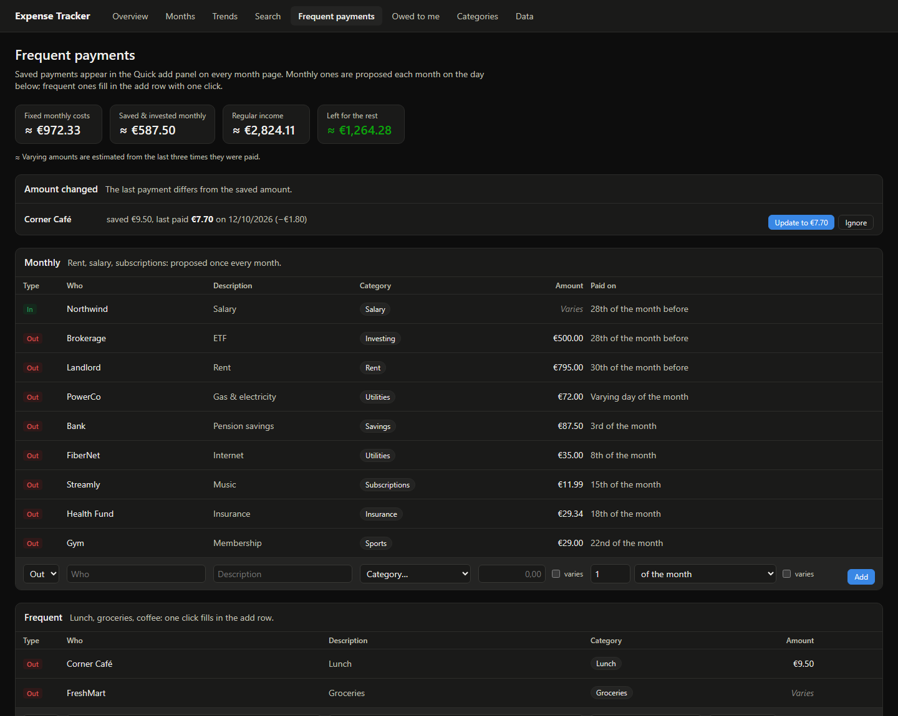
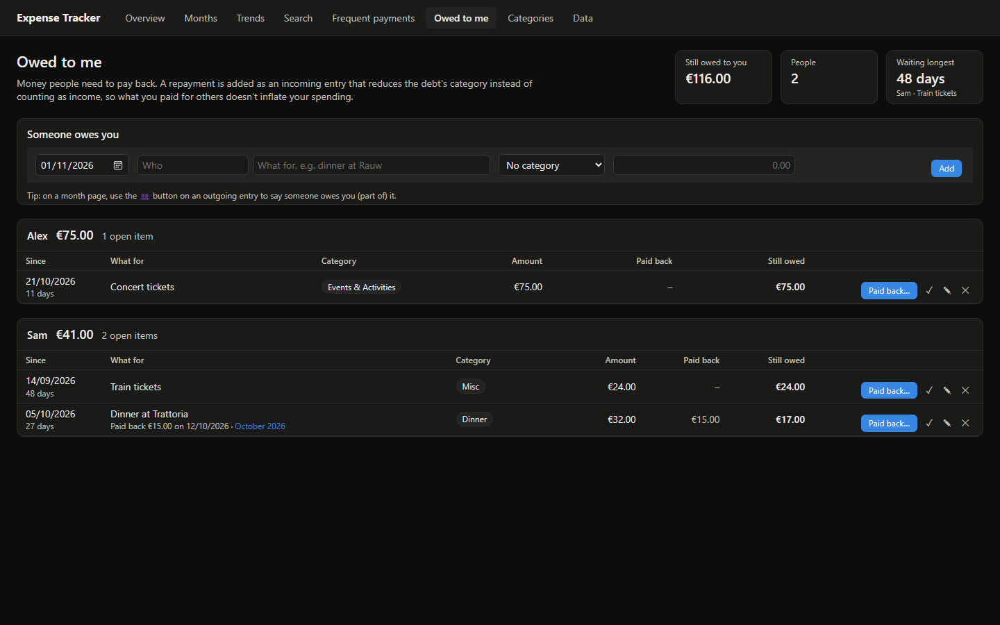

#  Expense Tracker

A personal finance app that runs entirely on your own machine. It started as a replacement for an "Income & Expenses" Google Sheet: a page per month with incoming and outgoing entries, a yearly overview per category, and editable categories. It has since grown trends, search, recurring payments and money-owed tracking.

All data lives in one local SQLite file. Nothing is sent anywhere.



## Features

- **Months**: incoming and outgoing entries per budget month, with income, spending, saving and what's left at the top, plus the expected balance at month end. Each category is compared with your 6-month average.
- **Overview**: totals per category per month for a whole year, a balance table, and a breakdown of any month with a donut chart.
- **Trends**: a monthly bar chart for any category or total, and a year-against-year comparison.
- **Search**: find entries across all months by who or description, filtered by type, category and year.
- **Quick add**: saved monthly payments (rent, salary, subscriptions) and frequent ones (lunch, groceries) that you add in one click. Amounts or days that vary are filled in when you add them.
- **Owed to me**: track money people need to pay back. Repayments reduce the expense they cover instead of counting as income.
- **Saving vs spending**: categories like Investing and Savings count as saved, not spent.
- **Import / export**: import month sheets from one specific Google Sheets layout, and export to Excel or CSV.
- **Backups**: a copy of the database is made automatically every day.

## Screenshots

_All screenshots use made-up sample data._

**Overview**: a year per category, with a balance table and a breakdown of the selected month.


**Trends**: spending per month against its average, and a year-against-year comparison.


**Frequent payments**: saved payments, fixed monthly costs and price-change alerts.


**Owed to me**: open debts per person, with partial repayments.


## Getting started

Requires **Node.js 22.13 or newer**. The app uses the built-in `node:sqlite`, so there are no native modules to compile.

```bash
npm install
npm start
```

Then open http://localhost:3000. `npm start` builds the frontend and serves it together with the API. The server only listens on `127.0.0.1`, so it can't be reached from other devices.

On Windows you can also double-click **`Expense Tracker.cmd`** or a shortcut to it. It starts the server in a minimized window if needed and opens the app in its own Edge window. Close the "Expense Tracker server" window to stop the app.

### Development

```bash
npm run dev        # API on :3000 with auto-restart, Vite with hot reload on :5173
npm run typecheck
```

### Configuration

| Variable   | Default | Purpose                              |
|------------|---------|--------------------------------------|
| `PORT`     | `3000`  | Port the server listens on           |
| `DATA_DIR` | `data`  | Folder for the database and backups  |

## Your data

- The database is `data/expenses.db`. Schema changes are applied automatically when the server starts.
- Each day the server saves a copy to `data/backups/` and keeps the last 14. **Back up now** on the Data page makes an extra copy that is never removed automatically.
- To restore a backup, stop the app and replace `data/expenses.db` with the backup file.
- `data/` is in `.gitignore`, so your financial data never ends up in the repository.

## How it works

### Budget months

Each entry belongs to a budget month, independent of its date. That way a salary paid on 28 December can count towards January, and a month can run from payday to payday, just like a month sheet in a spreadsheet.

### Saving vs spending

Expense categories marked **counts as saving** (on the Categories page) are shown as *saved & invested* instead of spending. "Not spent" is the share of income that wasn't spent: (income − spent) ÷ income.

### Repayments

An incoming entry can **pay back** an expense category ("↩ Pays back Subscriptions") or a specific debt on the Owed to me page. It then reduces that expense instead of counting as income, so a €60 dinner where a friend paid back €30 shows as €30 of dinner spending.

### Quick add

Payments you save on the **Frequent payments** page show up on every month page:

- **Monthly** payments have a day, e.g. "28th of the month before" for a salary. Click **Add**, or **Add all missing**.
- **Frequent** payments fill in the add row with one click, so you can adjust them before saving.
- Tick **varies** for an amount or day that changes. Those payments get **Fill in** instead of **Add**.

The Frequent payments page also shows your fixed monthly costs, and flags saved amounts that no longer match what you actually paid.

### Importing from Google Sheets

> **Note:** the import is built for one specific personal spreadsheet layout. Other spreadsheets, bank exports and other CSV formats are not supported.

The supported layout is one sheet per month with two side-by-side blocks headed exactly **Incoming** and **Outgoing**. Each block has five columns in this order: date (DD/MM/YYYY), who, description, amount (€) and category.

Export each month sheet with **File → Download → Comma-separated values (.csv)** and select all the files under **Import CSV** on the Data page.

- The budget month is taken from the file name (e.g. `Expenses 2026 - March.csv`) and can be changed per file.
- Category names are matched case-insensitively, and unknown ones are created.
- Entries that already exist are flagged, so re-importing a file is safe.
- An import is all or nothing: if one row fails, nothing is saved.

## Project structure

```
server/          Express API + SQLite
  index.ts       routes for categories, entries, saved payments, reports
  db.ts          schema, migrations, default categories
  debts.ts       money owed to you and its repayments
  reports.ts     net totals, search, saved-payment history
  backups.ts     daily and manual backups
  export.ts      Excel and CSV export
  validate.ts    shared request validation
shared/          code used by both server and client
src/             React frontend
  pages/         one file per page
  components/    QuickAdd, CategoryComparison, BarChart, Donut
  insights.ts    spent/saved split and averages
```

**Tech:** React 19, Vite, Express 5, `node:sqlite`, TypeScript, run directly with `tsx`.

## License

[MIT](LICENSE) © 2026 Daan Bergmans
